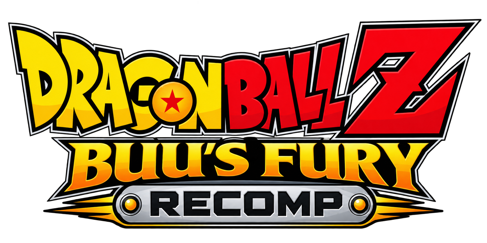

[](docs/logo.png)

[](https://ko-fi.com/novapowers)

# Dragon Ball Z: Buu's Fury Recomp

[English](README.md) · **Español**

Recompilación nativa para Windows de *Dragon Ball Z: Buu's Fury* (Game Boy
Advance) sobre el motor [gbarecomp](https://github.com/mstan/gbarecomp). El
código ARM original del juego se recompila estáticamente y se enlaza en un
ejecutable autónomo con su propio launcher y sistema de mods. Es un port real,
no un emulador.

[](../../releases)
[](../../releases)
[](LICENSE)
[](https://github.com/novapowers0/DragonBallZBuusFuryRecomp)
[](https://ko-fi.com/novapowers)
[](https://github.com/mstan/gbarecomp)

| | |
|---|---|
| **Jugadores** | 1 (un jugador) |
| **Plataforma** | Windows x64 |
| **Motor** | Game Boy Advance (gbarecomp) |
| **Género** | Action RPG |
| **Versión** | v0.0.8 (preview) |

Copyright (c) 2026 **NovaPowers**. Publicado bajo la PolyForm Noncommercial
License 1.0.0 (ver [`LICENSE`](LICENSE)).

**[⬇ Última compilación](../../releases)** · [Novedades](#novedades) ·
[Inicio rápido](#inicio-rápido) · [Mod de pantalla ancha](#mod-de-pantalla-ancha) ·
[Compilar desde el código](#compilar-desde-el-código)

---

## Novedades (v0.0.8)

**Correcciones**
- **Fusionarse ya no cierra el juego**: faltaban en el build estático unas 220
  rutinas de habilidades de Gotenks/Gogeta (y del menú de objetos); ahora están
  recompiladas. Todo el juego corre 100 % estático (sin compilar nada al vuelo)
  en las partidas probadas.
- **Fusión fallida + A en un círculo del mapa del mundo** ya no cuelga el juego,
  y se bloquea el exploit de las **255 Semillas del Ermitaño**. Ambas
  correcciones vienen activadas (`GBARECOMP_BF_FUSION_GUARD=0` /
  `GBARECOMP_BF_ITEM_GUARD=0` vuelven al comportamiento original).
- **Pantalla ancha**: desaparece la rejilla de puntos en los márgenes; el HUD se
  queda en el borde también mientras se ve el rótulo de la zona.
- **Perfil clásico 240 px**: el turbo con L, el avance con Select y el
  reproductor de música L+R funcionan también ahí, y mantener Select al caminar
  ya no pulsa A por su cuenta.
- Un estado guardado con el atajo de West City ya no se cuelga al cargarlo sin él.

**Pantalla ancha**
- Los logos ocupan todo el ancho y el **mapa del mundo** en vuelo extiende su
  cielo y la bruma del horizonte hasta los bordes.
- **Arte opcional de portada** para los márgenes (viñetas de manga nuevas en la
  portada española; cielo y Bola de Dragón en la USA), compuesto para cada ancho
  de ventana. Apagado por defecto; lo activa el perfil "extras" del lanzador.

**Contenido (menú de trucos, todo apagado por defecto)**
- **Todos los personajes de la historia en los círculos de guardado**: Goku,
  Gohan, Goten, Trunks y Vegeta desde cualquier círculo.
- **Gohan: forma Gran Saiyaman**, la forma sin terminar que quedó en el juego,
  y un truco que le devuelve la Super Saiyajin.

**Motor**
- Actualizado a gbarecomp y recomp-ui actuales: **audio estéreo** y alrededor de
  un **40 % más rápido** en el equipo de pruebas. Los estados guardados de la
  v0.0.7 siguen cargando (verificado fotograma a fotograma contra el build
  anterior).

## Lo más destacado

- **Pantalla ancha adaptativa** (mod opcional): revela mundo autoría real en los
  márgenes al ensanchar la ventana, sin estirar la imagen ni tocar la cámara.
- **Autosave con recuperación**: guarda una instantánea cada 30 s y reanuda la
  partida tras un cierre inesperado.
- **Herramientas de partida**: estados de guardado, avance rápido y rebobinado.
- **Cheats dentro del juego**: presets de CodeBreaker Advance (dinero, HP/EP,
  EXP, tiempo de fusión, Bolas de Dragón) más multiplicadores de ganancia/pérdida,
  todos apagados por defecto.
- **Editor de partida**: lee y cambia valores en vivo (dinero, HP/EP y sus
  máximos, EXP, Ataque y Bolas de Dragón).
- **Menú in-game con Start + Select**: abre herramientas, cheats y editor sin
  salir del juego.
- **Arranque rápido**: salta la intro del BIOS (reversible).
- **Cinco perfiles de color de pantalla**: Raw, Unlit, Frontlit, Backlit y Classic.
- **Launcher EN/ES** con carátula española cuando se detecta la traducción.
- **Audio corregido** (el crujido constante del mezclador original) y audio
  multijugador a la frecuencia real del mezclador.

## Novedades de este fork

| Cambio | Detalle |
|---|---|
| **Arranque rápido** | Salta la intro del BIOS por defecto (presentación; el BIOS real sigue ejecutándose para IRQ/SWI). Reversible con `--no-bios-skip-intro`. |
| **Arranque más rápido** | Los logos iniciales corren bajo el avance rápido de Assist Tools hasta el título, sin tocar la secuencia de fotogramas. `GBARECOMP_TURBO_BOOT` ajusta el número de fotogramas. |
| **Estado de arranque fiel** | El traspaso del BIOS ahora deja `DISPCNT` en *forced blank* (`0x0080`) y `POSTFLG=1`, y el PPU arranca en la fase skipBios de mGBA (`set_scanline_phase`), igual que el BIOS real y el oráculo. |
| **Autosave + recuperación** | Instantánea periódica junto a la ROM; si el proceso muere sin salir limpiamente, el siguiente arranque reanuda. Una salida normal no reanuda. |
| **Herramientas en el menú** | Estados (F1–F9 / Shift+F1–F9), avance rápido y rebobinado de 8 s, conmutables desde el menú del juego. |
| **Audio arreglado** | El motor mezcla a 32.768 Hz pero se reproducía como si fueran 65.536; el búfer quedaba siempre vacío y sonaba "petardeado". Ahora suena limpio. Suavizado opcional de un polo: `GBARECOMP_AUDIO_SMOOTH=1`. |
| **Fix de crash en el overworld** | Un *bridge runaway* en la zona inicial se resolvió ampliando la cobertura estática. |
| **Cobertura estática ampliada** | La zona inicial del overworld valida **FULLY STATIC** (0 misses, 0 interpretadas). |
| **Tres dumps equivalentes** | GoodTools/RA (`f1c4…`), No-Intro (`e657…`) y traducción al español (`ee667…`); un único código generado los sirve. |
| **Launcher EN/ES** | Selector de idioma cuando hay dump español, etiqueta de región "USA + Mod SPA" y carátula española. |
| **Cheats (in-game)** | Motor genérico de códigos **CodeBreaker Advance** con menú propio, presets de este cart y una herramienta de prueba *Walk Anywhere*; agrupados en secciones, todos apagados por defecto. |
| **Multiplicadores de cheats** | Vigilan un valor vivo y escalan cada cambio del juego: EXP ×2/×4, Zenie ×2/×4, daño recibido ×2/×0.5 y una curva de XP lenta. Ganancias, pérdidas y divisores se configuran por separado, y cada preset se auto-inicializa al activarse. |
| **Editor de partida** | Sección **Editor** en el menú del juego: lee y escribe valores vivos de la RAM (dinero, HP/EP, EXP, Ataque, Bolas de Dragón). |
| **Start + Select** | Atajo del anfitrión que abre el menú in-game (herramientas, cheats, editor) sin filtrarse al juego; A + B + Start + Select sigue reiniciando. Se indica en el launcher. |
| **Audio multijugador** | El modo link cable usaba 65.536 Hz fijos; ahora publica la frecuencia real del mezclador, igual que en un jugador. |
| **Fork sincronizado** | Al día con `mstan/DragonBallZBuusFuryRecomp`, incluido su escritor de ZIP portable (nombres con `/` para Linux/Steam Deck). |

## Estado

Preview **experimental**. La versión USA arranca, pasa la secuencia de atracción
y entra en gameplay; la validación estricta cubre atracción, gameplay y
recorridos sin instrucciones interpretadas ni dispatch misses. No se ha probado
de forma exhaustiva todo el juego, así que **haz copia de tus partidas**.

## Inicio rápido

1. Descarga el ZIP de Windows desde la pestaña **Releases** y extráelo.
2. Ejecuta `DragonBallZBuusFuryRecomp.exe`.
3. En el launcher elige tu ROM (USA, No-Intro o la traducción española) y la
   BIOS GBA retail.
4. Ajusta pantalla, audio, controles y mods, y pulsa **Play**.

Si está presente la traducción española, aparece un selector **EN/ES** junto a
*Mods*. El launcher recuerda los archivos válidos; marca **Skip launcher on
boot** para ir directo al juego en los siguientes arranques.

## Mod de pantalla ancha

**Buu's Fury Adaptive Widescreen** es opcional y está **desactivado por
defecto**. Al ensanchar la ventana, la vista lógica crece de 240×160 hasta
480×160 revelando mundo autoría real en los márgenes (no es un estirado ni un
recorte), con streaming de los chunks de campo y visibilidad de actores
ampliada. La imagen fiel **240×160 permanece idéntica** con el mod apagado.
Actívalo en la página **Mods** del launcher.

## Controles y atajos

| Control GBA | Teclado |
|---|---|
| D-Pad | Flechas |
| A / B | Z / X |
| Start | Enter |
| Select | Backspace |

- **Shift+F1–F9**: guardar estado · **F1–F9**: cargar estado.
- **Avance rápido** y **rebobinado**: desde el menú de herramientas del juego.
- **Start + Select**: abre el menú in-game (herramientas, cheats y editor).
- **Autosave**: automático cada 30 s mientras juegas en ventana.

Los controles se cambian desde el launcher.

## Compilar desde el código

Requisitos en Windows: CMake, Ninja, MSYS2 MinGW64 y SDL2.

```powershell
git clone --recurse-submodules `
  https://github.com/novapowers0/DragonBallZBuusFuryRecomp.git
cd DragonBallZBuusFuryRecomp

cmake -S gbarecomp -B gbarecomp/build -G Ninja
cmake --build gbarecomp/build --target gba_recompile
pwsh tools/regen.ps1
cmake -S . -B build -G Ninja -DCMAKE_BUILD_TYPE=Release
cmake --build build --target DragonBallZBuusFuryRecomp
```

La generación requiere la revisión de ROM soportada y una BIOS GBA retail; sus
identidades y rutas locales están en [`baserom.md`](baserom.md) y
[`game.toml`](game.toml). El código derivado de la ROM, los inputs con
copyright, las partidas y el output de build quedan **locales y nunca se suben**.

> **Carátula española**: el exe de release la lleva embebida. En un checkout de
> fuente, `gbarecomp/src/runtime/cover_embedded.h` no se distribuye (arte con
> copyright); el launcher compila igual sin ella.

## Verificación

`tools/regression_check.ps1` activa el mod de pantalla ancha, ejecuta el juego
sin ventana a 480 px y a 240 px desde los mismos estados, y comprueba que la
franja central de la imagen ancha coincide con la nativa (la mejora debe ser un
superconjunto exacto). Exige además que el fotograma realmente se ensanche.
Resultado del ejecutable de release: **57/57 escenas al 0,0000 %**.

## Legal

Proyecto no oficial, sin ánimo de lucro, de investigación y preservación. No
está afiliado ni avalado por Nintendo, Atari, Webfoot Technologies, Shueisha,
Toei Animation ni ningún titular de los derechos de Dragon Ball. Dragon Ball y
los nombres, personajes, arte y datos del juego relacionados son marcas o
copyright de sus respectivos dueños.

**No se distribuye** ninguna ROM, BIOS GBA de Nintendo, partida ni dato extraído
del juego. La carátula del launcher se incluye con fines de identificación.
Consulta [`baserom.md`](baserom.md) para los checksums y cómo aportar tus
propios archivos legales.

## Apoya el proyecto

[](https://ko-fi.com/novapowers)

Si te gusta mi trabajo de código abierto en recompilación estática y
preservación de software, considera apoyarlo. El juego y todo su contenido
siguen siendo gratis; apoyar es totalmente opcional.

## Licencia

El código original de este proyecto se distribuye bajo la
[PolyForm Noncommercial License 1.0.0](LICENSE) (autoría de mstan para el
proyecto original; este fork la conserva). Las aportaciones de NovaPowers se
publican bajo esa misma licencia.

## Créditos

- **Matthew Stanley (mstan)** — recompilador `gbarecomp`, launcher `recomp-ui` y
  estructura del proyecto original.
- **R.A.I.D. — Retro AI Development** — comunidad de recompilación estática.
- **NovaPowers** — este fork: fix de crash, cobertura ampliada, soporte de tres
  dumps, launcher EN/ES, arreglo de audio, arranque fiel, arranque rápido,
  autosave, herramientas de partida, cheats y multiplicadores, editor de partida
  y actualización del mod Adaptive Widescreen.

---

Parte de la comunidad **R.A.I.D. — Retro AI Development**.
