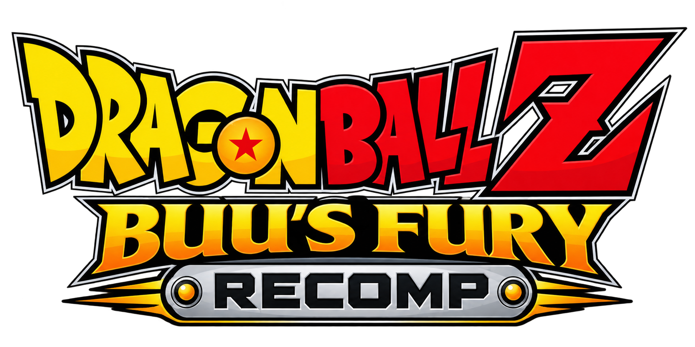

[](docs/logo.png)

[](https://ko-fi.com/novapowers)

# Dragon Ball Z: Buu's Fury Recomp

**English** · [Español](README.es.md)

A native Windows recompilation of *Dragon Ball Z: Buu's Fury* (Game Boy Advance)
built on the [gbarecomp](https://github.com/mstan/gbarecomp) runtime. The game's
original ARM code is statically recompiled and linked into a standalone
executable with its own launcher and mod system. It is a real port, not an
emulator.

[](../../releases)
[](../../releases)
[](LICENSE)
[](https://github.com/novapowers0/DragonBallZBuusFuryRecomp)
[](https://ko-fi.com/novapowers)
[](https://github.com/mstan/gbarecomp)

| | |
|---|---|
| **Players** | 1 (single-player) |
| **Platform** | Windows x64 |
| **Engine** | Game Boy Advance (gbarecomp) |
| **Genre** | Action RPG |
| **Version** | v0.0.6-WIP (preview) |

Copyright (c) 2026 **NovaPowers**. Released under the PolyForm Noncommercial
License 1.0.0 (see [`LICENSE`](LICENSE)).

**[⬇ Latest build](../../releases)** · [What's new](#whats-new) ·
[Quick start](#quick-start) · [Widescreen mod](#widescreen-mod) ·
[Building from source](#building-from-source)

---

## What's new

- **Boot matches the real BIOS handoff**: the fast boot now leaves `DISPCNT`
  forced-blank and `POSTFLG` set exactly like the real BIOS (and mGBA), and the
  PPU starts on mGBA's skipBios phase.
- **Cheat multipliers**: EXP/Zenie ×2/×4, damage taken ×2/×0.5 and a slow XP
  curve, grouped under *Cheats - Multipliers* and *Cheats - Difficulty* (all off
  by default).
- **Faster boot**: the startup logos fast-forward to the title screen (~1 s
  instead of ~8), with the guest frame sequence untouched.
- **Faster margins**: the adaptive widescreen render now resolves each field tile
  once per frame (about +8 % at 480 px), pixel-identical to before.
- **Start + Select guard**: A + B + Start + Select still soft-resets the game
  (the BIOS reset passes through) while Start + Select opens the in-game menu.
- **Opt-in audio smoothing** (`GBARECOMP_AUDIO_SMOOTH=1`).

## Highlights

- **Adaptive widescreen** (optional mod): reveals real authored world in the
  margins as the window widens, without stretching the image or touching the
  camera.
- **Autosave with recovery**: takes a snapshot every 30 s and resumes the game
  after an unexpected close.
- **In-game tools**: save states, fast-forward and rewind.
- **In-game cheats**: CodeBreaker Advance presets (money, HP/EP, EXP, fusion
  time, Dragon Balls) plus gain/loss multipliers, all off by default.
- **Save editor**: read and change live values (money, HP/EP and their maxima,
  EXP, Attack and Dragon Balls).
- **In-game menu with Start + Select**: opens the tools, cheats and editor
  without leaving the game.
- **Fast boot**: skips the BIOS intro (reversible).
- **Five screen colour profiles**: Raw, Unlit, Frontlit, Backlit and Classic.
- **EN/ES launcher** with Spanish box art when the translation is detected.
- **Fixed audio** (the original mixer's constant crackle) and multiplayer audio
  at the mixer's real rate.

## What this fork adds

| Change | Detail |
|---|---|
| **Fast boot** | Skips the BIOS intro by default (presentation only; the real BIOS still runs for IRQ/SWI). Reversible with `--no-bios-skip-intro`. |
| **Faster boot** | The startup logos run under Assist Tools fast-forward until the title screen, so the frame sequence is untouched. `GBARECOMP_TURBO_BOOT` overrides the frame count. |
| **Faithful boot state** | The BIOS handoff now leaves `DISPCNT` forced-blank (`0x0080`) and `POSTFLG=1`, and the PPU starts on mGBA's skipBios phase (`set_scanline_phase`), matching the real BIOS and the oracle. |
| **Autosave + recovery** | Periodic snapshot next to the ROM; if the process dies without a clean exit, the next launch resumes. A clean exit does not resume. |
| **In-menu tools** | States (F1–F9 / Shift+F1–F9), fast-forward and 8 s rewind, toggled from the in-game menu. |
| **Fixed audio** | The engine mixes at 32,768 Hz but was played back as if it were 65,536; the buffer was always empty and it sounded "poppy". Now it is clean. Optional one-pole smoothing: `GBARECOMP_AUDIO_SMOOTH=1`. |
| **Overworld crash fix** | A bridge runaway in the starting area was resolved by widening static coverage. |
| **Wider static coverage** | The starting overworld validates **FULLY STATIC** (0 misses, 0 interpreted). |
| **Three equivalent dumps** | GoodTools/RA (`f1c4…`), No-Intro (`e657…`) and the Spanish translation (`ee667…`); one generated image serves them all. |
| **EN/ES launcher** | Language selector when the Spanish dump is present, region label "USA + Mod SPA" and Spanish box art. |
| **Cheats (in-game)** | Generic **CodeBreaker Advance** engine with its own menu, this cart's presets and a *Walk Anywhere* test tool; grouped into sections, all off by default. |
| **Cheat multipliers** | Watch a live value and scale every guest change: EXP ×2/×4, Zenie ×2/×4, damage taken ×2/×0.5 and a slow XP curve. Gains, losses and divisors are configured independently, and each preset seeds itself when enabled. |
| **Save editor** | **Editor** section in the in-game menu: reads and writes live RAM values (money, HP/EP, EXP, Attack, Dragon Balls). |
| **Start + Select** | Host shortcut that opens the in-game menu (tools, cheats, editor) without leaking into the game; A + B + Start + Select still soft-resets. Shown in the launcher. |
| **Multiplayer audio** | The link-cable mode assumed a fixed 65,536 Hz; it now publishes the mixer's real rate, just like single-player. |
| **Synced fork** | Up to date with `mstan/DragonBallZBuusFuryRecomp`, including its portable ZIP writer (`/` entry names for Linux/Steam Deck). |

## Status

**Experimental** preview. The USA version boots, plays its attract sequence and
reaches gameplay; strict validation covers attract, gameplay and traversal with
no interpreted instructions and no dispatch misses. The whole game has not been
tested exhaustively, so **back up your saves**.

## Quick start

1. Download the Windows ZIP from the **Releases** tab and extract it.
2. Run `DragonBallZBuusFuryRecomp.exe`.
3. In the launcher, pick your ROM (USA, No-Intro or the Spanish translation) and
   the retail GBA BIOS.
4. Adjust display, audio, controls and mods, then press **Play**.

If the Spanish translation is present, an **EN/ES** selector appears next to
*Mods*. The launcher remembers valid files; tick **Skip launcher on boot** to go
straight to the game on later launches.

## Widescreen mod

**Buu's Fury Adaptive Widescreen** is optional and **off by default**. As the
window widens, the logical view grows from 240×160 up to 480×160, revealing real
authored world in the margins (it is neither a stretch nor a crop), with field
chunk streaming and expanded actor visibility. The faithful **240×160 image
stays identical** with the mod off. Enable it on the launcher's **Mods** page.

## Controls and shortcuts

| GBA control | Keyboard |
|---|---|
| D-Pad | Arrow keys |
| A / B | Z / X |
| Start | Enter |
| Select | Backspace |

- **Shift+F1–F9**: save state · **F1–F9**: load state.
- **Fast-forward** and **rewind**: from the in-game tools menu.
- **Start + Select**: opens the in-game menu (tools, cheats and editor).
- **Autosave**: automatic every 30 s while playing in a window.

Controls are changed in the launcher.

## Building from source

Windows requirements: CMake, Ninja, MSYS2 MinGW64 and SDL2.

```powershell
git clone --recurse-submodules `
  https://github.com/novapowers0/DragonBallZBuusFuryRecomp.git
cd DragonBallZBuusFuryRecomp

cmake -S gbarecomp -B gbarecomp/build -G Ninja
cmake --build gbarecomp/build --target gba_recompile
pwsh tools/regen.ps1
cmake -S . -B build -G Ninja -DCMAKE_BUILD_TYPE=Release
cmake --build build --target DragonBallZBuusFuryRecomp
```

Generation requires the supported ROM revision and a retail GBA BIOS; their
identities and local paths are in [`baserom.md`](baserom.md) and
[`game.toml`](game.toml). ROM-derived code, copyrighted inputs, saves and build
output stay **local and are never uploaded**.

> **Spanish box art**: the release exe embeds it. In a source checkout,
> `gbarecomp/src/runtime/cover_embedded.h` is not distributed (copyrighted art);
> the launcher still builds without it.

## Verification

`tools/regression_check.ps1` enables the widescreen mod, runs the game headless
at 480 px and at 240 px from the same states, and checks that the central strip
of the wide image matches the native one (the enhancement must be an exact
superset). It also requires the frame to actually widen. Result for the release
executable: **57/57 scenes at 0.0000 %**.

## Legal

Unofficial, non-commercial research and preservation project. Not affiliated
with or endorsed by Nintendo, Atari, Webfoot Technologies, Shueisha, Toei
Animation or any Dragon Ball rights holder. Dragon Ball and the related names,
characters, art and game data are trademarks or copyright of their respective
owners.

**No** ROM, Nintendo GBA BIOS, save or extracted game data is distributed. The
launcher box art is included for identification purposes. See
[`baserom.md`](baserom.md) for the checksums and how to supply your own legal
files.

## Support the project

[](https://ko-fi.com/novapowers)

If you enjoy my open-source work on static recompilation and software
preservation, consider supporting it. The game and all of its content stay free;
supporting is completely optional.

## License

The original code of this project is distributed under the
[PolyForm Noncommercial License 1.0.0](LICENSE) (mstan's authorship for the
original project; this fork keeps it). NovaPowers' contributions are released
under that same license.

## Credits

- **Matthew Stanley (mstan)** — `gbarecomp` recompiler, `recomp-ui` launcher and
  the original project structure.
- **R.A.I.D. — Retro AI Development** — static-recompilation community.
- **NovaPowers** — this fork: crash fix, wider coverage, three-dump support,
  EN/ES launcher, audio fix, faithful boot, fast boot, autosave, in-game tools,
  cheats and multipliers, save editor and the Adaptive Widescreen mod update.

---

Part of the **R.A.I.D. — Retro AI Development** community.
